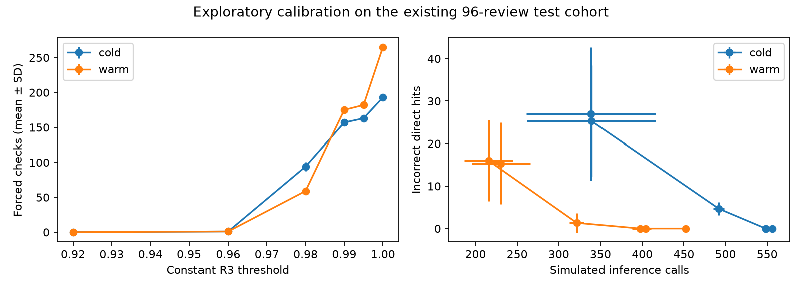
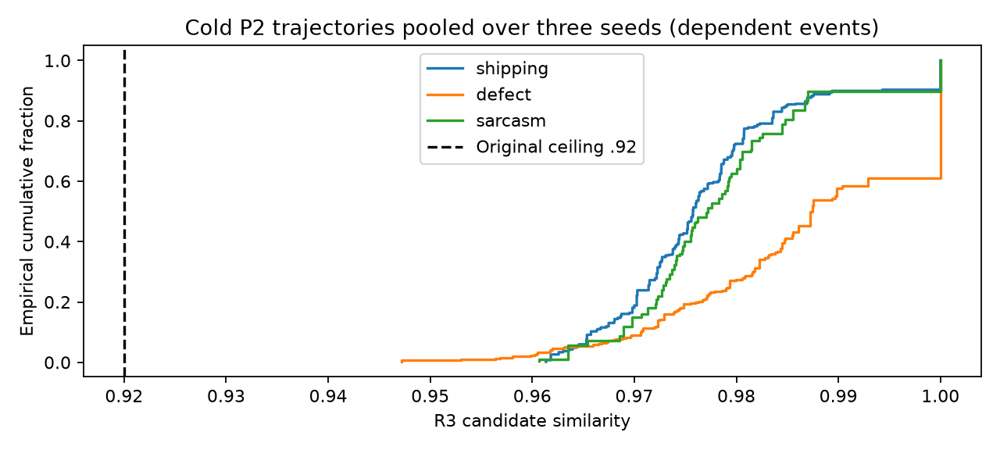

# Calibration supplement

Exploratory post-hoc analysis | 26 October 2026

This supplement accompanies the revised conference paper. The original report retains its original study scope; the current interpretation is a calibration diagnosis, with a selectivity-specific advantage still unestablished.

## Design and provenance

The original test result was already known when this diagnostic design was chosen. The 42 additional offline runs use seven settings, two cache states and three seeds (17–19), adding 504 measured query executions on the same 96 test reviews. No independent reviews or API requests were added. Original replay comprised 110 runs and 1,320 query executions; repetition does not turn the combined 1,824 executions into independent data.

The validation-quantile rule uses q10 = 0.9676635929526995 and q90 = 1.0 from 206 R3 events in one validation P2 cold trajectory. The quantile levels were chosen post hoc. Using validation scores does not make the existing test set untouched again. Constant settings change only the R3 score threshold; the quantile rule varies it with global selectivity. The posterior and executor are unchanged.

The plan records separate hashes for the original freeze file and its embedded payload. Full run logs are in `results/study/calibration/raw/`; configuration, zero-API-use, raw aggregates and constant-0.92 event signatures are checked in `results/study/calibration/verification.json`.

## Mechanism

An extra check requires R3 membership and score z < tau(s). If every eligible score is at least the configured upper bound, the added rule cannot intervene. With identical inputs, initial state, saved-label oracle and posterior random stream, P2 and P3 then follow the same trajectory. P3 uses a separate controller random stream and an inactive check does not alter posterior sampling.

The pooled main P2 cold R3 minimum is 0.947187 and warm minimum 0.954605, above the original 0.92 ceiling. These are actual eligible events rather than arbitrary pairwise scores. Repeated events across seeds, predicates and queries are dependent.

## Full calibration results

Values are mean ± sample SD over three seeds. Set agreement and call reduction are percentages; their SDs are percentage points. Calls are simulated measured-pass inferences excluding warmup. IDH = incorrect direct hits against saved model outputs. Checks = selectivity-threshold-forced inferences.

| Rule | State | Calls | IDH | Checks | Set agreement % | Call reduction % |
|---|---|---|---|---|---|---|
| constant_0.92 | cold | 338.7 ± 77.5 | 27.0 ± 15.7 | 0.0 ± 0.0 | 52.8 ± 21.0 | 41.7 ± 13.3 |
| constant_0.92 | warm | 230.7 ± 35.3 | 15.3 ± 9.6 | 0.0 ± 0.0 | 61.1 ± 21.0 | 60.3 ± 6.1 |
| constant_0.96 | cold | 339.0 ± 77.1 | 25.3 ± 13.1 | 1.0 ± 1.7 | 52.8 ± 21.0 | 41.7 ± 13.3 |
| constant_0.96 | warm | 215.7 ± 29.0 | 16.0 ± 9.5 | 1.0 ± 1.0 | 58.3 ± 22.0 | 62.9 ± 5.0 |
| constant_0.98 | cold | 492.0 ± 6.6 | 4.7 ± 1.5 | 94.0 ± 6.2 | 75.0 ± 8.3 | 15.3 ± 1.1 |
| constant_0.98 | warm | 321.7 ± 8.7 | 1.3 ± 2.3 | 59.0 ± 2.0 | 97.2 ± 4.8 | 44.6 ± 1.5 |
| constant_0.99 | cold | 548.3 ± 1.5 | 0.0 ± 0.0 | 157.0 ± 0.0 | 100.0 ± 0.0 | 5.6 ± 0.3 |
| constant_0.99 | warm | 397.3 ± 9.5 | 0.0 ± 0.0 | 175.0 ± 0.0 | 100.0 ± 0.0 | 31.6 ± 1.6 |
| constant_0.995 | cold | 548.3 ± 2.5 | 0.0 ± 0.0 | 163.0 ± 0.0 | 100.0 ± 0.0 | 5.6 ± 0.4 |
| constant_0.995 | warm | 404.0 ± 7.0 | 0.0 ± 0.0 | 182.0 ± 0.0 | 100.0 ± 0.0 | 30.5 ± 1.2 |
| constant_1.0 | cold | 556.0 ± 2.6 | 0.0 ± 0.0 | 193.0 ± 0.0 | 100.0 ± 0.0 | 4.3 ± 0.5 |
| constant_1.0 | warm | 452.3 ± 4.9 | 0.0 ± 0.0 | 265.0 ± 0.0 | 100.0 ± 0.0 | 22.1 ± 0.8 |
| validation_q10_q90 | cold | 447.0 ± 2.0 | 18.3 ± 0.6 | 119.7 ± 1.2 | 52.8 ± 4.8 | 23.1 ± 0.3 |
| validation_q10_q90 | warm | 335.0 ± 15.6 | 7.3 ± 2.3 | 84.0 ± 19.1 | 58.3 ± 8.3 | 42.3 ± 2.7 |

A constant 0.99 threshold has zero incorrect direct hits and 100% complete query row set agreement in this replay, at 5.6% cold and 31.6% warm call savings. This is neither an optimal-setting claim nor a selectivity-dependent method. The quantile rule activates but retains incorrect direct hits and only 52.8% cold / 58.3% warm mean set agreement. A threshold at 1.0 also depends on numerical cosine equality for repeated inputs.

## Score distributions

Groups by predicate and query type partition the same events in two different ways. n is event count, not independent review count.

| State | Grouping | Group | n | Min | q10 | Median | q90 | Max |
|---|---|---|---|---|---|---|---|---|
| cold | predicate | shipping | 536 | 0.961338 | 0.966027 | 0.975751 | 0.994317 | 1.000000 |
| cold | query_type | broad | 424 | 0.947187 | 0.965311 | 0.974797 | 0.984766 | 0.990336 |
| cold | predicate | defect | 311 | 0.947187 | 0.970784 | 0.987491 | 1.000000 | 1.000000 |
| cold | predicate | sarcasm | 195 | 0.960629 | 0.968919 | 0.977178 | 1.000000 | 1.000000 |
| cold | query_type | medium | 187 | 0.960629 | 0.968735 | 0.978522 | 1.000000 | 1.000000 |
| cold | query_type | narrow | 59 | 0.961821 | 0.971477 | 0.986920 | 1.000000 | 1.000000 |
| cold | query_type | multi | 230 | 0.961821 | 0.972902 | 0.989866 | 1.000000 | 1.000000 |
| cold | query_type | repeat | 142 | 0.961821 | 0.968735 | 0.977778 | 1.000000 | 1.000000 |
| warm | predicate | shipping | 612 | 0.954605 | 0.968067 | 0.978407 | 1.000000 | 1.000000 |
| warm | query_type | broad | 647 | 0.954605 | 0.970142 | 0.984721 | 1.000000 | 1.000000 |
| warm | predicate | defect | 559 | 0.963710 | 0.980579 | 1.000000 | 1.000000 | 1.000000 |
| warm | predicate | sarcasm | 295 | 0.964242 | 0.975509 | 1.000000 | 1.000000 | 1.000000 |
| warm | query_type | medium | 328 | 0.961821 | 0.972521 | 1.000000 | 1.000000 | 1.000000 |
| warm | query_type | narrow | 67 | 0.961821 | 0.974884 | 1.000000 | 1.000000 | 1.000000 |
| warm | query_type | multi | 287 | 0.961821 | 0.975922 | 1.000000 | 1.000000 | 1.000000 |
| warm | query_type | repeat | 137 | 0.961821 | 0.970774 | 0.980638 | 1.000000 | 1.000000 |

## The no-cache denominator

There are 12 query plans, three distinct predicates and 14 semantic stages. One stage receives zero rows. In multi-predicate plans, the later stage receives preceding reference-positive survivors. One simulated inference per stage input gives 581. Cached errors can change later-stage inputs, so candidate counts differ across policies. Call reduction is 100 × (581 − measured calls)/581.

| Query | Shipping | Defect | Sarcasm | Total |
|---|---|---|---|---|
| broad_shipping | 96 | 0 | 0 | 96 |
| broad_defect | 0 | 96 | 0 | 96 |
| broad_sarcasm | 0 | 0 | 96 | 96 |
| low_shipping | 49 | 0 | 0 | 49 |
| low_defect | 0 | 49 | 0 | 49 |
| rating3_sarcasm | 0 | 0 | 16 | 16 |
| cheap_shipping | 12 | 0 | 0 | 12 |
| expensive_defect | 0 | 12 | 0 | 12 |
| empty_shipping | 0 | 0 | 0 | 0 |
| low_defect_shipping | 20 | 49 | 0 | 69 |
| repeat_low_shipping | 49 | 0 | 0 | 49 |
| high_sarcasm_defect | 0 | 6 | 31 | 37 |

## Limits and next confirmatory study

Mistral outputs are fallible references, not human gold labels. The assistant audit of 24 validation pairs was not independent human annotation. Human accuracy, multiple-dataset transfer and independently replicated live runtime remain unmeasured. See `human_annotation_protocol.md` and `revision_checklist.md` for the remaining work. A fresh study must freeze calibrated constant and selectivity rules on new validation data before testing untouched corpora.

## Reproduction

Run `python -m scripts.calibration_diagnostics` to validate/resume offline evidence and regenerate tables and plots. Incompatible saved configurations are rejected. Run `python -m scripts.report_revision` to regenerate this supplement and retain the scope notice on the original report. Neither command makes provider requests.
