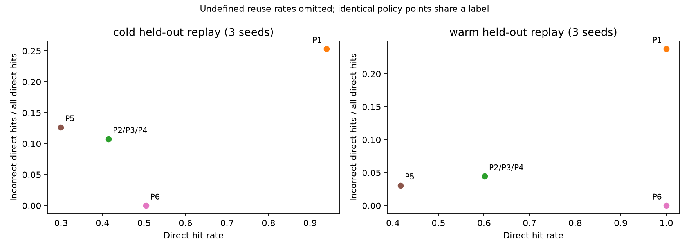
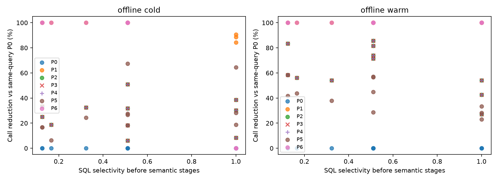
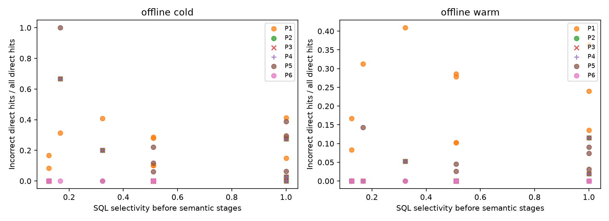
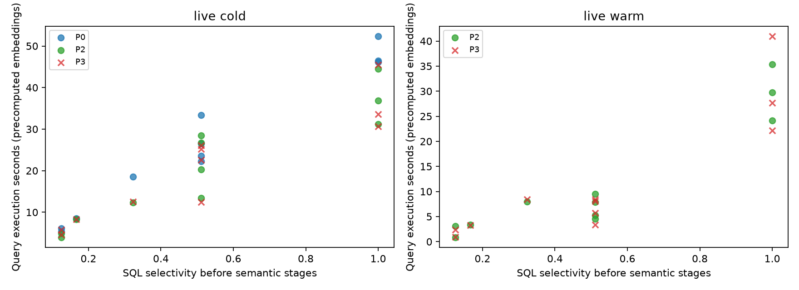
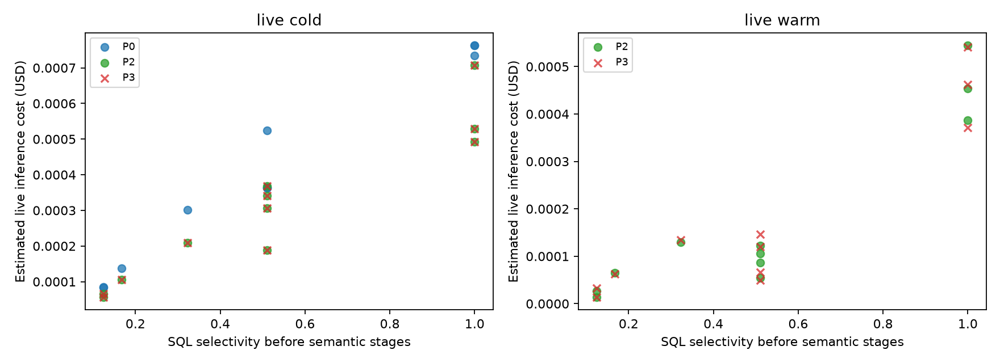
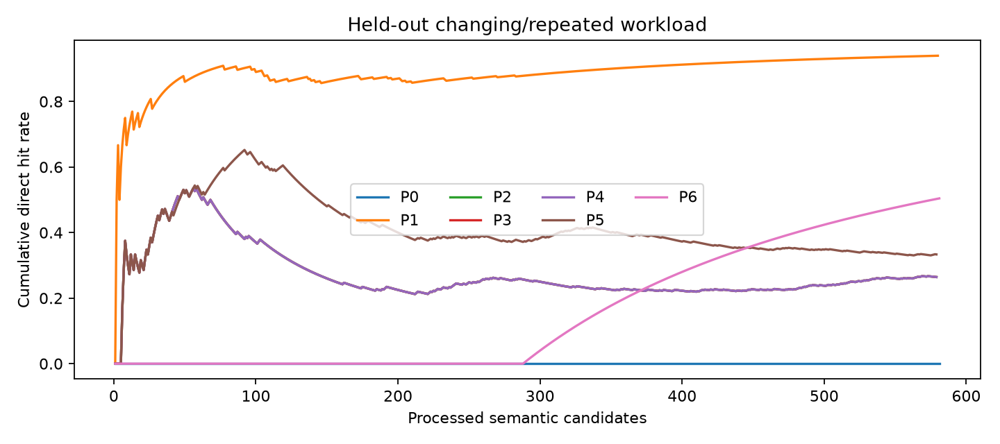
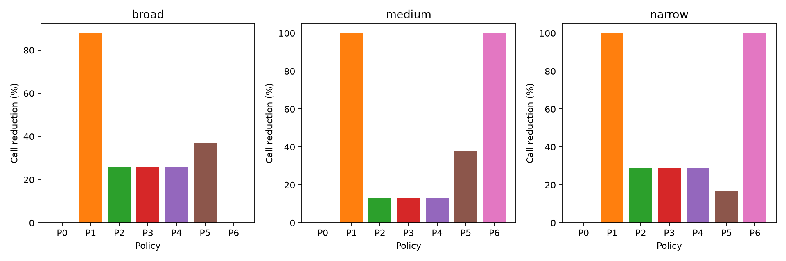
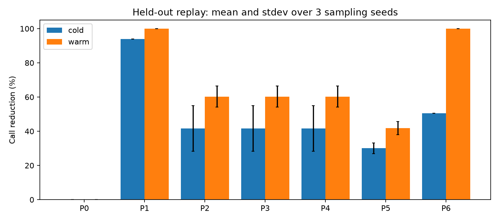

> Original study report (110 replay runs and five live conditions). For the revised calibration argument and the separate 42-run post-hoc analysis, read [the calibration supplement](calibration.md) and the revised conference paper. The following narrative retains its original study scope.

# Adaptive Semantic Caching with VectorQ for Hybrid SQL-LLM Query Pipelines

Measured challenge study | 26 October 2026 | Asia/Calcutta

## 1. Abstract and problem statement

Hybrid SQL-LLM queries first filter structured records and then evaluate semantic predicates. A semantic cache can avoid inference but may change the final selected rows. This project implements and tests a correctness-adaptive cache and asks whether preceding-filter selectivity helps allocate inference more effectively.

On the held-out cold workload, P2 averaged 338.7 simulated calls and 27.0 incorrect direct hits; P3 averaged 338.7 calls and 27.0 incorrect hits. P3 minus P2 was +0.0 calls and +0.0 incorrect hits. This is a measured trade-off on the fixed challenge corpus, not a universal improvement claim.

The completed experiment uses 64 validation reviews and 96 held-out test reviews from the supplied real CSV, with a separately frozen configuration and mixed YES/NO model labels. Seven policies share one executor and benchmark runner. Offline replay, actual network inference, preprocessing and warmup are accounted separately.

## 2. Research question and hypothesis

Research question: does SQL query selectivity improve the trade-off between correct cache reuse and LLM inference cost when added to VectorQ? The main hypothesis is that fewer surviving rows justify a stricter R3 reuse gate. Reverse gating and selectivity-dependent auditing test alternative explanations. A null, negative or mixed outcome is a legitimate finding.

The contribution is the use of live query-stage selectivity inside an existing correctness-adaptive cache. Adaptive thresholds in general are not claimed as new.

## 3. Related work and algorithm identity

The base method follows Algorithms 1 and 2 in Adaptive Semantic Prompt Caching with VectorQ, arXiv:2502.03771v1 (6 February 2025). It is identified as a paper-v1 reimplementation. The current official repository implements later vCache; the inspected historical VectorQ-named Bayesian policy is also a different algorithm.

Official master inspected: 50694eebf0c870231030f73707cb6543d47f0411. Historical commits and downloaded source hashes are saved in research/vectorq_source_manifest.json. No upstream three-region runtime test suite was executed, so this project does not claim a byte-identical upstream reproduction or later vCache error guarantees. Local paper-derived conformance tests include analytic posterior checks, region transitions and sampling.

## 4. System architecture

Unmodified CSV -> cleaning manifest -> indexed SQLite -> explicit query plan -> structured SQL stages -> semantic stages -> compatible cache lookup -> policy/controller -> validated inference when required. Reference labels bypass caching and are stored independently.

The application supports Mistral and Ollama interfaces, strict YES/NO validation, timeouts, rate-limit handling, explicit retries, provider model identity, latency, token usage and estimated cost. Failed requests do not become fabricated NO labels. Predicate, prompt, model, embedding model, dataset version and run isolate cached state.

## 5. Dataset and preprocessing

Dataset.csv has 363,261 source rows and 307,953 retained canonical records. Source Summary holds review bodies; Review holds headlines. Blank bodies are dropped, canonical duplicates removed, invalid prices/ratings become null, and absent category remains null. Source bytes are not modified. Latin-1 is an explicit byte-preserving interpretation, not a repair of existing encoding damage.

The supplied file has no verified upstream publisher, license, release or Amazon provenance. Its SHA-256 and cleaning configuration establish the local version; unknown provenance is not invented.

Validation and test bodies are grouped by normalized text hash before sampling, so identical text cannot cross the split even when product metadata differ. The original ten-review pilot is excluded. Eligibility is 20-1,200 characters without truncation. Eight predeclared strata cover cheap low-rated, expensive low-rated, shipping cues, defect cues, sarcasm cues, other low, medium and high ratings. Validation has eight and test twelve records per stratum. These are enriched challenge cohorts, not prevalence-representative samples. Lexical cues select rows; they never supply labels.

## 6. VectorQ algorithm

R1 rejects reuse, calls the model and inserts the current result. R2 performs a correctness check and updates the correct or incorrect observations. R3 uses posterior-driven sampling to choose between a correctness check and direct reuse. An incorrect R3 check moves covered correct observations into the rejection region.

The posterior uses the localized exponential likelihood in Algorithm 2 on a 1,001-point grid, normalized by trapezoidal integration and maintained in log space. Analytic single-observation and finer-grid tests verify this numerical representation. Decay 10 is a documented development setting. The integral equation can yield densities above one, despite conflicting prose in the paper; such values force a check under Algorithm 1.

Vector search is an explicit exact-cosine development fallback, using NumPy float64 dot products over stored normalized vectors. Negative cosine is clipped to zero to match the paper score domain. Learned region/posterior decisions are retained; the base policy is not a static cosine threshold.

## 7. Selectivity controller and implementation

Global selectivity is remaining rows divided by the cohort total. Stage-local selectivity is rows after divided by rows before the preceding stage. Each stage records its input/output counts and time. Empty SQL results bypass embeddings and inference.

P3 uses tau_min + (tau_max - tau_min) * (1-s)^gamma as an additional R3 gate. A rejected R3 candidate forces a real correctness check and the same metadata update as an ordinary audit. At/above the gate, VectorQ sampling still applies. P4 reverses the exponent input to s. P5 adds a separate selectivity-dependent audit probability. None can bypass R1/R2.

The implementation uses transactional SQLite with foreign keys, WAL journaling and synchronous=NORMAL, explicit dataset and prompt versions, deterministic query plans, fixed seeds and per-run JSONL logs. Successful committed state persists across process restarts; random-stream crash resumption is not implemented, so interrupted benchmarks restart in a new run.

## 8. Experimental setup and baselines

P0 no cache; P1 static threshold; P2 original-paper VectorQ; P3 selectivity gate; P4 reverse gate; P5 selectivity auditing; P6 exact task/version/input keys. The 12-query workload includes broad, medium, narrow, empty, repeated and changing semantic contexts, including multiple predicates.

Parameters were selected using validation cold/warm replay only. The predeclared criterion seeks incorrect reuse <=2% and query row-set agreement >=90%, then minimizes combined calls. If no trial is feasible, the fallback minimizes incorrect direct hits and then calls. This rule and all trials are saved. The chosen configuration is content-addressed and checked before test execution.

None of the ten validation trials met both feasibility targets. The recorded fallback was therefore used. The selected settings must not be described as satisfying the target error bound or result-agreement constraint.

Frozen settings: {"audit_max": 0.5, "audit_min": 0.05, "decay": 10, "fixed_threshold": 0.96, "gamma": 1, "grid_size": 1001, "selectivity_kind": "global", "tau_max": 0.92, "tau_min": 0.72, "uncertainty_gate": 0.5}. Freeze SHA-256: 07e40272507623d4149be4633a7cf42eee5ae291dd5bc2990ce0b5def1da5ff7.

The main held-out replay repeats cold and warm runs for seeds 17, 18 and 19. Separate reverse/shuffled orders and one-factor ablations are predeclared diagnostics, not post-test tuning. The live primary comparison uses actual Mistral requests for P0/P2/P3 cold and P2/P3 warm, including independently logged warmup. A persistent 3,000-attempt ledger bounds total study runtime spending.

Models: ministral-3b-2512 and mistral-embed-2312. Inference uses temperature 0, seed 17, a four-token cap and prompt v2. Embeddings are precomputed and shared fairly; measured embedding time is vector retrieval, not network encoding. Shared preparation calls/costs are reported separately.

## 9. Tests and metrics

The fresh virtual environment installed requirements.txt successfully. Its executed pytest result is 119 tests, 0 failures/errors. Tests cover data/import idempotence, SQL pushdown, thresholds, vector search, insertion, persistence, namespaces, regions, posterior/sampling, inference failures, full query results, budgets, split leakage and frozen-setting tampering.

Cache hit rate is direct hits/all candidates. Incorrect reuse is incorrect direct hits/all direct hits and is undefined with zero hits. Audits are actual/simulated inference calls, never direct hits. Call reduction is 100 * (P0 calls - policy calls) / P0 calls. Exact per-run denominators are saved rather than hidden behind averages.

Final row-set agreement compares IDs against the no-cache model-reference pipeline; incorrectly included/excluded IDs and direct-hit false positives/negatives are separate. Query latency includes SQL, cache work and inference in the executor, excluding offline setup, warmup and analysis. Median/p95 timings and cache overhead are saved. Token-price cost estimates are not billing statements.

## 10. Results and graphs

On the held-out cold workload, P2 averaged 338.7 simulated calls and 27.0 incorrect direct hits; P3 averaged 338.7 calls and 27.0 incorrect hits. P3 minus P2 was +0.0 calls and +0.0 incorrect hits. This is a measured trade-off on the fixed challenge corpus, not a universal improvement claim.

Warm replay averaged 230.7 P2 calls versus 230.7 P3 calls; incorrect direct hits averaged 15.3 versus 15.3. The tables below show all seven policies, with means over the three fixed-order seeds.

Completed held-out runs: 110; main conditions: 42; live primary conditions: 5. P3 selectivity-forced checks in main replay: 0. Unlike the original pilot, nonempty selective queries are present.

The selected gate triggered no additional checks in the main held-out runs. Nearest-neighbor similarities stayed above its eligible R3 thresholds. Equal P2/P3 outcomes therefore show no measured benefit for this frozen configuration, not that every stronger or differently calibrated selectivity controller is ineffective. Test outcomes were not used to retune it.

Live runtime including warmup: 2779 request attempts, 214011 input tokens, 5558 output tokens, estimated $0.021957. Reference generation, including the rejected prompt-v1 run, used 960 recorded attempts. Embedding preparation and its partial interrupted pass are kept separate; uncertain in-flight setup usage is not silently counted as zero.

### cold

| Policy | Calls mean | Hits mean | Wrong hits | Reuse error | Set agreement |
|---|---|---|---|---|---|
| P0 | 581.0 | 0.0 | 0.0 | undefined | 1.000 |
| P1 | 35.0 | 545.0 | 138.0 | 0.253 | 0.083 |
| P2 | 338.7 | 239.3 | 27.0 | 0.108 | 0.528 |
| P3 | 338.7 | 239.3 | 27.0 | 0.108 | 0.528 |
| P4 | 338.7 | 239.3 | 27.0 | 0.108 | 0.528 |
| P5 | 406.3 | 173.3 | 22.0 | 0.126 | 0.500 |
| P6 | 288.0 | 293.0 | 0.0 | 0.000 | 1.000 |

### warm

| Policy | Calls mean | Hits mean | Wrong hits | Reuse error | Set agreement |
|---|---|---|---|---|---|
| P0 | 581.0 | 0.0 | 0.0 | undefined | 1.000 |
| P1 | 0.0 | 580.0 | 138.0 | 0.238 | 0.083 |
| P2 | 230.7 | 348.0 | 15.3 | 0.044 | 0.611 |
| P3 | 230.7 | 348.0 | 15.3 | 0.044 | 0.611 |
| P4 | 230.7 | 348.0 | 15.3 | 0.044 | 0.611 |
| P5 | 338.3 | 241.7 | 7.3 | 0.031 | 0.722 |
| P6 | 0.0 | 581.0 | 0.0 | 0.000 | 1.000 |

### Live primary comparison

| Policy | State | Calls | Audits | Wrong / hits | Set agreement | Seconds |
|---|---|---|---|---|---|---|
| P0 | cold | 581 | 0 | 0 / 0 | 0.917 | 289.08 |
| P2 | cold | 426 | 341 | 13 / 153 | 0.750 | 230.88 |
| P3 | cold | 426 | 341 | 13 / 153 | 0.750 | 227.18 |
| P2 | warm | 245 | 220 | 8 / 334 | 0.750 | 131.71 |
| P3 | warm | 248 | 226 | 5 / 332 | 0.833 | 131.57 |

## 10a. Preparation cost accounting

Reference preparation estimated cost: $0.006588. Persisted embedding batches report 54246 input tokens and estimated $0.005425. Known total experiment spend is approximately $0.033969. A possibly in-flight batch from the interrupted old prompt run is not included in that known total; its provider billing is uncertain. These setup costs are distinct from runtime misses/audits.

## 11. Ablation study and variability

The suite compares P2 with P3, reverse direction, audit integration, global versus stage-local selectivity, changed maximum threshold and gamma, stronger correctness sampling, stronger audits, exact-key reuse and alternative arrival orders. All raw outcomes remain available, including worse-performing variants.

Paired bootstrap intervals resample the three matched sampling seeds on this same fixed corpus. They describe conditional seed variability only. They are not confidence intervals for independent populations or proof of statistical superiority. Quantitative intervals and per-run timing stdev are in the tables. No held-out result was used to change the frozen primary configuration.

## 12. Error analysis and label quality

The initial prompt produced NO for explicit malfunction reviews. This was found on validation, preserved under v1 and excluded from the main study. Prompt v2 puts the task beside the review in the user message; a stored validation sanity check correctly classified an explicit non-working product as YES. The v2 model identity and prompt version prevent stale v1 reuse.

Validation v2 label counts: [["defect", "NO", 43], ["defect", "YES", 21], ["sarcasm", "NO", 49], ["sarcasm", "YES", 15], ["shipping", "NO", 56], ["shipping", "YES", 8]]. Test v2 counts: [["defect", "NO", 72], ["defect", "YES", 24], ["sarcasm", "NO", 73], ["sarcasm", "YES", 23], ["shipping", "NO", 87], ["shipping", "YES", 9]].

A seeded validation-only sample of 24 task/review pairs was qualitatively inspected by the assistant: 20 agreements out of 22 scorable cases, 2 disagreements and 2 ambiguous task boundaries. The apparent mistakes include sarcasm false positives. This is not independent human ground truth. The reviewed CSV preserves notes and does not overwrite reference labels.

The fresh live P0 no-cache run also differed from saved reference row sets (agreement 0.917). No cache hits occurred in P0, so these differences are not semantic-cache reuse errors. They are consistent with remote-model nondeterminism despite fixed seed/temperature. Explicit mismatched labels are preserved in live_reference_variation.json and are not hidden by relabeling.

The live warm P2/P3 conditions also differ slightly, despite no selectivity-forced checks. Fresh model outputs changed cache-learning histories. Those warm differences must not be attributed to a selectivity benefit; replay against the common saved labels gives the controlled P2/P3 comparison.

Observed cache disagreements therefore measure fidelity to this selected model, not human semantic accuracy. All final row-set claims use that same reference definition.

## 13. Limitations

The study is small and deliberately enriched, uses one dataset with unknown upstream provenance, one inference model, one embedding model and a paper-based numerical VectorQ implementation. Character eligibility and distinct-text selection narrow the population. Model reference errors, ambiguous predicate boundaries and damaged source text remain.

The live study runs three independent conditions concurrently, each with sequential cache decisions and its own state. Live latencies include shared client/server contention and are exploratory; they are not isolated service benchmarks.

Precomputed embeddings exclude encoding network latency from measured query times. Shared encoding setup is not a free production cost. Live comparisons are the primary subset; all seven policies are compared in replay. Repeated seeds reuse one corpus, and a single live timing sequence cannot establish general latency guarantees. Larger independent corpora, human annotations and a verified upstream three-region implementation would strengthen external validity.

## 14. Conclusion and future work

On the held-out cold workload, P2 averaged 338.7 simulated calls and 27.0 incorrect direct hits; P3 averaged 338.7 calls and 27.0 incorrect hits. P3 minus P2 was +0.0 calls and +0.0 incorrect hits. This is a measured trade-off on the fixed challenge corpus, not a universal improvement claim.

The project now provides an integrated application, automated tests, versioned reference labels, disjoint validation/test cohorts, frozen settings, a common seven-policy suite, live accounting, raw logs, tables, graphs and this report. It supplies evidence for the measured conditional trade-off; it does not claim that selectivity always improves VectorQ.

Future work should repeat the study on independently sourced corpora, include human-adjudicated labels and more embedding models, evaluate live encoding, and test query arrival drift and larger cache populations.

## 15. Reproducibility and deliverables

Windows CMD: python -m venv .venv; .venv\Scripts\activate; python -m pip install -r requirements.txt; python -m pytest -q. Keep MISTRAL_API_KEY in the ignored .env file. API keys are never part of recorded configuration.

CSV preparation: python -m scripts.prepare_data. Cohorts: python -m scripts.prepare_study. Study inputs: python -m scripts.study_inputs --config config/study.json. All-policy benchmark: python -m scripts.run_benchmark --config config/study.json. Figures: python -m scripts.plot_results. Report: python -m scripts.build_final_report.

The complete commands, cost/export scope and cautions against re-tuning after test are in README.md. Raw logs are under results/study/validation/raw, test/raw and live/raw. Tables, figures, frozen settings, input manifests, quality review and clean-setup test XML accompany the code. Dependency versions are pinned in requirements.txt and requirements-lock.txt.

## 16. References

Schroeder et al. Adaptive Semantic Prompt Caching with VectorQ. arXiv:2502.03771v1. https://arxiv.org/html/2502.03771v1

Official VectorQ/vCache source and historical snapshots. https://github.com/vcache-project/vCache

Mistral model documentation. https://docs.mistral.ai/models/ministral-3-3b-25-12 and https://docs.mistral.ai/models/mistral-embed-23-12

Mistral API specifications. https://docs.mistral.ai/api/endpoint/chat and https://docs.mistral.ai/api/endpoint/embeddings

Ollama alternative provider API. https://docs.ollama.com/api/generate
